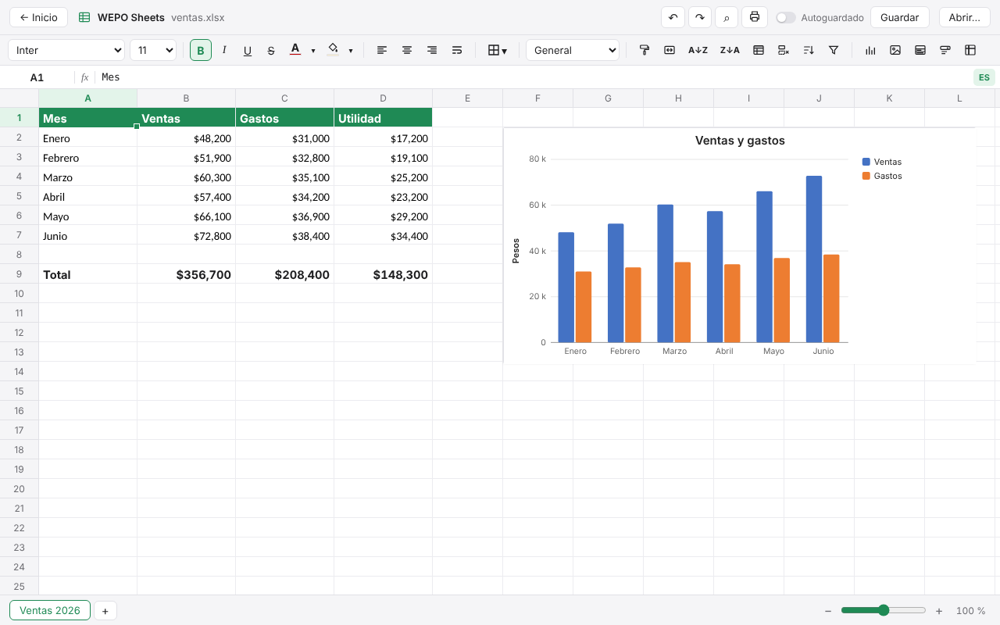
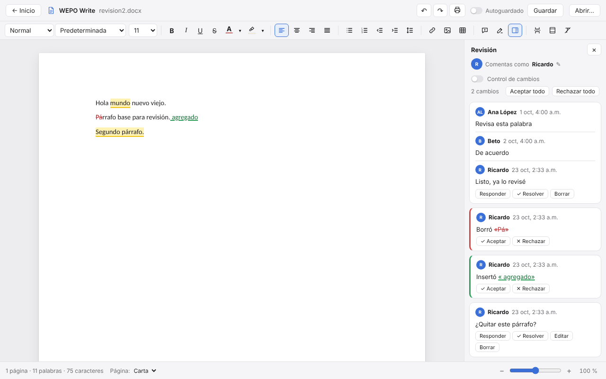
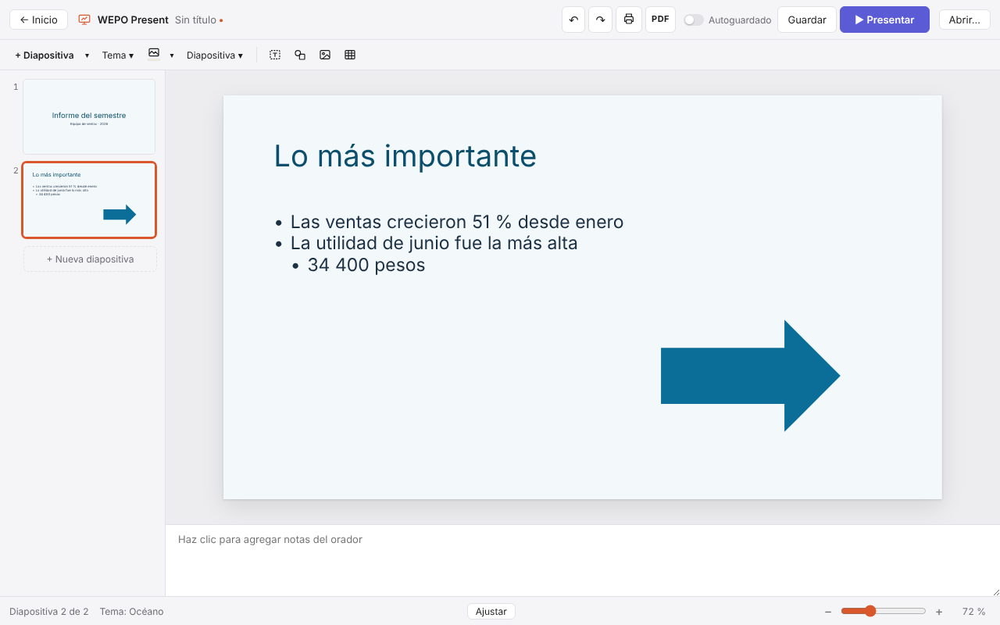
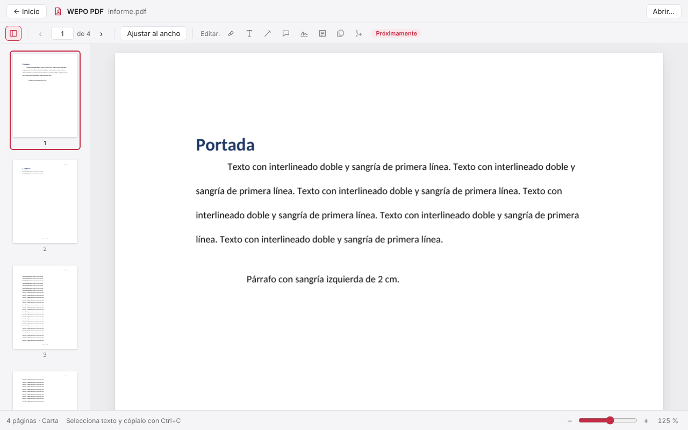
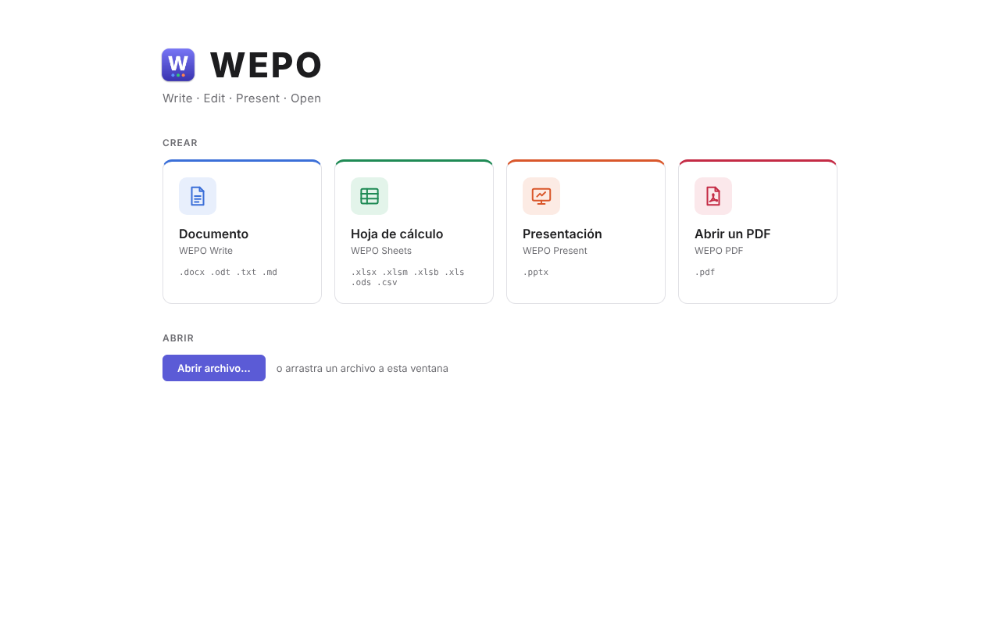
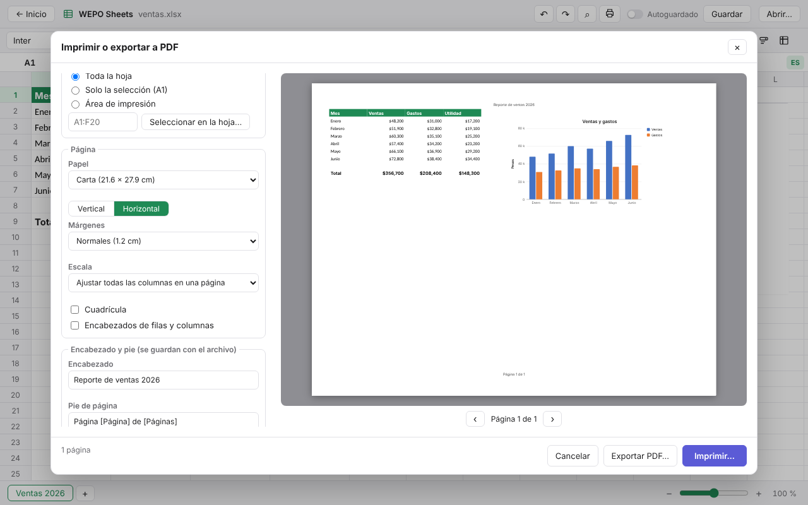
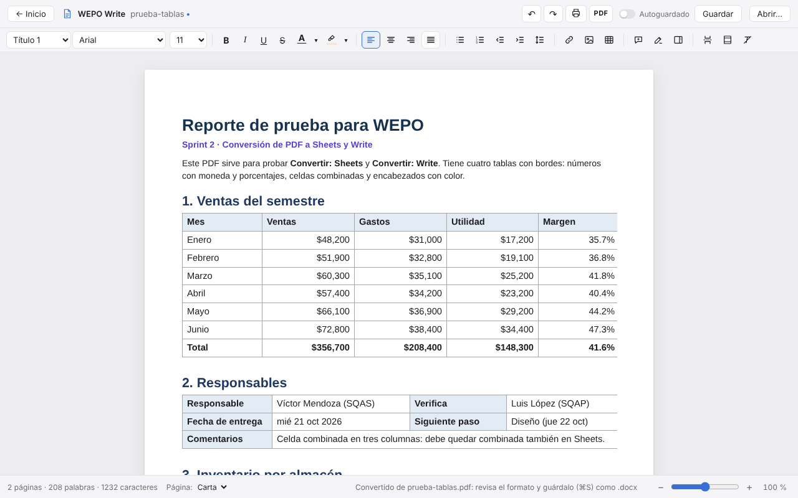

# WEPO

**Write · Edit · Present · Open**

WEPO es una suite de oficina ligera y de código abierto para macOS, Windows y Linux. Abre y edita documentos, hojas de cálculo y presentaciones de Microsoft Office (y de LibreOffice) y PDF, en una sola aplicación. Exporta cualquier documento a PDF y convierte un PDF en documento editable o en hoja de cálculo.



| WEPO Write | WEPO Present |
|---|---|
|  |  |
| **WEPO PDF** | **Inicio** |
|  |  |
| **Imprimir con vista previa** | **Un PDF convertido en documento de Write** |
|  |  |

## Descargar

La versión más reciente está en [**Releases**](../../releases): hay instaladores para Mac (chip Apple e Intel), Windows y Linux. Los cambios de cada versión están en el [CHANGELOG](CHANGELOG.md).

> WEPO está en desarrollo activo. La [hoja de ruta](#hoja-de-ruta) dice qué funciona hoy.

## Editores

| Editor | Para | Formatos |
|---|---|---|
| **WEPO Write** | Documentos de texto | .docx, .txt, .md (y abre .odt) |
| **WEPO Sheets** | Hojas de cálculo | .xlsx, .xlsm, .xlsb, .xls, .ods, .csv |
| **WEPO Present** | Presentaciones | .pptx |
| **WEPO PDF** | Ver, editar y convertir PDF (a Write o a Sheets) | .pdf |

## Tecnología

- **[Tauri 2](https://tauri.app/)**: aplicación de escritorio de pocos MB, mucho más ligera que una basada en Electron.
- **Rust**: núcleo que lee y escribe los formatos de archivo.
  - [IronCalc](https://github.com/ironcalc/ironcalc): motor de hojas de cálculo con fórmulas, deshacer/rehacer y lectura y escritura de .xlsx.
  - [calamine](https://github.com/tafia/calamine) y [csv](https://github.com/BurntSushi/rust-csv): lectura de .xls, .xlsb, .ods y .csv.
- **React + TypeScript**: interfaz de cada editor.
- **[pdf.js](https://mozilla.github.io/pdf.js/)** y **[pdf-lib](https://pdf-lib.js.org/)**: dibujan y editan los PDF en WEPO PDF.
- **[TipTap](https://tiptap.dev/)** y **[JSZip](https://stuk.github.io/jszip/)**: editor de texto de WEPO Write y lectura y escritura de .docx.
- **[TanStack Virtual](https://tanstack.com/virtual)**: la cuadrícula solo dibuja las celdas visibles, así que los archivos grandes se mantienen fluidos.

## Estructura del proyecto

```
src/                      Interfaz (React + TypeScript)
├── App.tsx               Decide qué pantalla o editor mostrar
├── screens/Home.tsx      Pantalla de inicio: crear o abrir
├── editors/
│   ├── sheets/           WEPO Sheets
│   ├── present/          WEPO Present: editor, diapositivas y lector/escritor de .pptx
│   ├── pdf/              WEPO PDF: visor y edición (pdfEdit.ts guarda con pdf-lib)
│   ├── write/            WEPO Write: editor, páginas (extensions.ts) y lector/escritor de .docx
│   └── ComingSoon.tsx    Marcador de los editores en construcción
├── components/           Piezas compartidas (barra superior, íconos)
└── lib/                  Tipos de documento, recientes, órdenes del menú y comunicación con Rust

src-tauri/                Núcleo nativo (Rust)
├── src/lib.rs            Comandos que la interfaz puede llamar
├── src/mac.rs            Menú de la app, archivos abiertos desde Finder e impresión
├── src/recovery.rs       Copia de recuperación de lo que no se ha guardado
├── src/windows.rs        Una ventana por documento
├── src/files.rs          Leer y guardar archivos de WEPO Write
├── src/sheets.rs         Hojas de cálculo: abrir, editar, calcular, copiar/pegar, deshacer y guardar
├── src/sheets/
│   ├── structure.rs      Filas, columnas, celdas combinadas, paneles inmovilizados, pestañas, autollenado
│   ├── data.rs           Ordenar, filtrar, buscar y reemplazar
│   ├── conditional.rs    Formato condicional (reglas, barras de datos, íconos)
│   ├── validation.rs     Listas desplegables
│   ├── annotations.rs    Notas, vínculos, pegado especial y resumen de la selección
│   ├── tables.rs         Tablas y configuración de página
│   └── drawings.rs       Gráficas e imágenes
├── src/xlsx_extras.rs    Partes del .xlsx que el motor no maneja (se leen y escriben aparte)
└── src/sheet_format.rs   Formato de celdas (fuentes, colores, bordes, alineación)

src/editors/sheets/functions.ts  Catálogo de funciones en español e inglés (generado del motor)
src/editors/sheets/PrintSheet.tsx Versión de la hoja para imprimir o guardar como PDF
.github/workflows/        Revisión automática y creación de los instaladores
docs/capturas/            Capturas de pantalla del README
```

## Ejecutar en desarrollo

Requisitos: macOS, [Rust](https://rustup.rs/), Node.js y las herramientas de línea de comandos de Xcode.

```bash
npm install
npm run tauri dev
```

Pruebas del núcleo en Rust:

```bash
cd src-tauri
cargo test
```

Pruebas de la interfaz (carpeta `e2e/`): abren los archivos de ejemplo de `e2e/fixtures/`, imprimen, exportan a PDF, convierten y guardan, como lo haría una persona. Corren en Chromium con el motor de Rust de verdad (un puente en `src-tauri/examples/e2e_bridge.rs`), y GitHub las corre en cada cambio.

```bash
npx playwright install chromium   # solo la primera vez
npm run test:e2e                  # todas (la primera vez compila el puente: tarda unos minutos)
npx playwright test e2e/write.spec.ts --headed   # una sola, viendo el navegador
```

## Crear la app e instalarla

Para generar `WEPO.app` y el instalador `.dmg` en tu Mac:

```bash
npm run tauri build
```

Al terminar quedan en `src-tauri/target/release/bundle/macos/WEPO.app` y `src-tauri/target/release/bundle/dmg/`. Abre el .dmg y arrastra WEPO a la carpeta Aplicaciones.

También puedes dejar que GitHub lo haga: al subir una etiqueta de versión (`git tag v0.3.1 && git push origin v0.3.1`) el flujo `.github/workflows/release.yml` crea un borrador en **Releases** con un .dmg para Mac con chip Apple y otro para Mac con Intel.

**Primera vez que la abres:** WEPO todavía no está firmado por Apple, así que macOS no la deja abrir con doble clic. Haz clic derecho sobre WEPO en Aplicaciones → **Abrir** → **Abrir**. Solo hace falta una vez.

**Abrir archivos con WEPO desde Finder:** WEPO se registra para .xlsx, .xlsm, .xls, .ods, .csv, .docx, .odt, .md, .pptx y .pdf. Haz clic derecho en un archivo → **Abrir con** → WEPO. Para que siempre se abran con WEPO: clic derecho → **Obtener información** → **Abrir con:** WEPO → **Cambiar todo…**

## Windows

WEPO también funciona en Windows 10 y 11. En Windows los atajos usan **Ctrl** en lugar de **⌘** (Ctrl+S, Ctrl+C, Ctrl+Z…).

- **Instalador:** en **Releases** del repositorio, descarga el archivo `x64-setup.exe` y ábrelo. Si aparece «Windows protegió tu PC», elige **Más información** → **Ejecutar de todas formas** (la app aún no está firmada).
- **Desde el código:** instala [Git](https://git-scm.com/download/win), [Node.js LTS](https://nodejs.org/), [Rust](https://rustup.rs/) y las [Build Tools de Visual Studio](https://visualstudio.microsoft.com/visual-cpp-build-tools/) con «Desarrollo para el escritorio con C++». Luego, en la carpeta del proyecto: `npm install` y `npm run tauri dev`.
- **Crear el instalador en Windows:** `npm run tauri build`. Queda en `src-tauri\target\release\bundle\nsis\` (.exe) y `bundle\msi\` (.msi).

## Linux

WEPO también funciona en Linux (Ubuntu 22.04 o más nuevo, Debian, Fedora y similares). Los atajos usan **Ctrl**, como en Windows.

- **Instalador:** en **Releases** hay tres formatos:
  - `.AppImage`, para casi cualquier distribución: `chmod +x WEPO_*.AppImage` y ábrelo.
  - `.deb`, para Ubuntu, Debian o Mint: `sudo apt install ./WEPO_*.deb`.
  - `.rpm`, para Fedora u openSUSE: `sudo dnf install ./WEPO-*.rpm`.
- **Desde el código** (Ubuntu/Debian):
  ```bash
  sudo apt install libwebkit2gtk-4.1-dev libgtk-3-dev libayatana-appindicator3-dev librsvg2-dev libxdo-dev libssl-dev build-essential curl git
  curl --proto '=https' --tlsv1.2 -sSf https://sh.rustup.rs | sh   # Rust
  # Node.js LTS desde https://nodejs.org o con tu gestor de paquetes
  git clone https://github.com/ricardo-rodriguezdesk/WEPO.git && cd WEPO
  npm install
  npm run tauri dev
  ```

## Atajos de WEPO Write

En Windows y Linux, ⌘ es Ctrl.

| Atajo | Qué hace |
|---|---|
| ⌘B / ⌘I / ⌘U | Negrita, cursiva, subrayado |
| ⌘⇧X | Tachado |
| ⌘K | Insertar o editar un vínculo (⌘ + clic lo abre) |
| ⌘↩ | Salto de página |
| ⌘F | Buscar y reemplazar |
| ⌘⌥M | Comentar el texto seleccionado |
| ⌘⌥F | Nota al pie (clic en su número o en la nota para cambiarla) |
| ⌘⇧E | Encender o apagar el control de cambios |
| ⌘S / ⌘⇧S | Guardar / Guardar como (.docx, .md o .txt) |
| ⌘P | Imprimir o exportar a PDF |
| Doble clic en el encabezado o el pie | Editarlos |

## Atajos de WEPO Present

En Windows y Linux, ⌘ es Ctrl.

| Atajo | Qué hace |
|---|---|
| F5 / ⇧F5 | Presentar desde el inicio / desde la diapositiva actual |
| → o espacio / ← | Siguiente / anterior (al presentar) |
| Número + ↩ | Ir a esa diapositiva (al presentar) |
| V | Vista del presentador (notas, siguiente y tiempo) |
| B / W | Pantalla negra / blanca (al presentar) |
| ⌘M | Nueva diapositiva |
| Doble clic o ↩ | Escribir en el cuadro seleccionado |
| Tab / ⇧Tab | Subir o bajar el nivel de la viñeta |
| ⇧ + clic, ⌘A | Seleccionar varios elementos |
| Flechas (⇧ para más) | Mover lo seleccionado |
| ⌘D, ⌘C, ⌘V | Duplicar, copiar y pegar elementos |
| ⌘P | Imprimir o exportar a PDF |

## Atajos de WEPO Sheets

| Acción | Atajo |
|---|---|
| Escribir en una celda | Empieza a teclear, o F2 / doble clic para editar lo que ya tiene |
| Confirmar y bajar / ir a la derecha | Enter / Tab |
| Cancelar la edición | Esc |
| Seleccionar un rango | Shift + flechas, o arrastrar con el mouse |
| Borrar la selección | Delete |
| Copiar / cortar / pegar | ⌘C / ⌘X / ⌘V (también con Excel, Numbers y Google Sheets) |
| Negrita / cursiva / subrayado | ⌘B / ⌘I / ⌘U |
| Cambiar ancho de columna o alto de fila | Arrastra el borde del encabezado |
| Seleccionar fila o columna completa | Clic en su número o letra |
| Menú con más opciones | Clic derecho en una celda, encabezado o pestaña |
| Autollenar una serie o fórmula | Arrastra la esquina inferior derecha de la selección |
| Llenar hacia abajo | ⌘D, o doble clic en la esquina de la selección |
| Seleccionar la tabla actual | ⌘A |
| Buscar y reemplazar | ⌘F |
| Renombrar una hoja | Doble clic en su pestaña |
| Insertar una función sugerida | ↑↓ para elegir, Tab o ↩ para insertar |
| Insertar una referencia en una fórmula | Clic (o arrastrar) en las celdas, o flechas justo después de `=`, `(`, `,` o un operador |
| Alternar referencia relativa/absoluta | F4 (A1 → $A$1 → A$1 → $A1) |
| Abrir la lista desplegable de una celda | ⌥↓ o clic en su flecha |
| Ajustar el ancho de una columna a su texto | Doble clic en el borde de su encabezado |
| Editar una gráfica | Doble clic sobre ella |
| Mover una gráfica o imagen seleccionada | Arrastrar, o flechas (⇧ para 10 px) |
| Borrar una gráfica o imagen seleccionada | Delete |
| Deshacer / rehacer | ⌘Z / ⌘⇧Z |
| Guardar / guardar como | ⌘S / ⌘⇧S |
| Imprimir o exportar a PDF | ⌘P |
| Pegar solo valores | ⌘⇧V (y en el clic derecho: solo formato, transpuesto) |
| Copiar formato | Botón de la brocha (doble clic para aplicarlo varias veces; Esc para terminar) |
| Insertar o editar una nota | ⇧F2, o clic derecho → Insertar nota |
| Insertar o editar un vínculo | ⌘K; ⌘ + clic en la celda para abrirlo |
| Insertar una función (buscar por nombre o categoría) | Botón **fx** de la barra de fórmulas |
| Nueva ventana / abrir en otra ventana | ⌘N / ⌘O con un documento abierto |
| Acercar / alejar / 100 % | ⌘+ / ⌘− / ⌘0, pellizcar en el trackpad, o el control de zoom junto a las pestañas |
| Nueva hoja de cálculo / abrir archivo | ⌘N / ⌘O |
| Salir de WEPO | ⌘Q (avisa si hay cambios sin guardar) |

## Fórmulas en español o en inglés

WEPO entiende más de 490 funciones. Puedes escribirlas en español (`=SUMA`, `=SI`, `=BUSCARV`, `=SUMAR.SI.CONJUNTO`) o en inglés (`=SUM`, `=IF`, `=VLOOKUP`); el botón **ES/EN** de la barra de fórmulas cambia el idioma. En el archivo .xlsx siempre se guardan en inglés, así que se abren bien en cualquier versión de Excel.

## Hoja de ruta

- [x] Abrir hojas de cálculo (.xlsx, .xls, .ods, .csv) con todas sus hojas
- [x] Pantalla de inicio y apertura de archivos por extensión o arrastrándolos a la ventana
- [x] WEPO Sheets: editar celdas, navegar con el teclado, fórmulas, deshacer/rehacer y guardar en .xlsx y .csv
- [x] WEPO Sheets: formato de celdas (fuente, tamaño, negrita, colores, bordes, alineación, formato de número)
- [x] WEPO Sheets: copiar, cortar y pegar con fórmulas y formato; ancho de columnas y alto de filas
- [x] WEPO Sheets: insertar, eliminar y ocultar filas/columnas, combinar celdas, inmovilizar paneles, autollenado
- [x] WEPO Sheets: ordenar, filtrar, buscar y reemplazar; renombrar, duplicar, mover y eliminar hojas
- [x] WEPO Sheets: fórmulas en español o inglés, autocompletado con ayuda de argumentos, referencias de colores, F4
- [x] WEPO Sheets: formato condicional (resaltar, superiores/inferiores, barras de datos, escalas de color, íconos)
- [x] WEPO Sheets: listas desplegables, texto que se desborda, alto automático de filas, autoajuste de columnas
- [x] WEPO Sheets: gráficas (columnas, barras, líneas, áreas, pastel, dona, dispersión) que se leen y guardan en .xlsx
- [x] WEPO Sheets: imágenes (PNG, JPEG, GIF)
- [x] WEPO Write: abrir, editar y guardar .docx (también .md y .txt)
- [x] WEPO Write: páginas reales con saltos de página, encabezado y pie con número de página (se leen y guardan en .docx)
- [x] WEPO Write: buscar y reemplazar, interlineado, espacio entre párrafos y sangrías
- [x] WEPO Write: autoguardado y recuperación si la app se cierra de golpe
- [x] WEPO Write: abrir documentos de LibreOffice (.odt)
- [x] WEPO Write: tablas con celdas combinadas, color de celda y ancho de columnas
- [x] WEPO Write: comentarios (con respuestas y resueltos) y control de cambios, compatibles con Word
- [x] WEPO PDF: ver PDF con miniaturas, zoom, ir a una página, copiar texto y PDF con contraseña
- [x] WEPO PDF: ordenar, girar y quitar páginas, combinar con otro PDF y guardar páginas como PDF nuevo
- [x] WEPO PDF: resaltar, agregar texto, dibujar, notas adhesivas, firmar y rellenar formularios
- [x] WEPO Present: abrir, editar y guardar .pptx (texto, formas, imágenes, tablas, notas del orador y temas)
- [x] WEPO Present: tablas, seleccionar varios elementos, alinear y repartir, girar, cambiar el diseño, imagen de fondo y tamaño 16:9 o 4:3
- [x] WEPO Present: modo presentación con vista del presentador (notas, siguiente diapositiva y tiempo), imprimir y exportar a PDF, autoguardado y recuperación
- [x] App de Mac: menú en español, imprimir y exportar a PDF, archivos recientes, aviso de cambios sin guardar
- [x] App de Mac: abrir archivos desde Finder, ícono propio e instalador .dmg
- [x] WEPO Sheets: zoom de la hoja de 25 % a 400 %
- [x] WEPO Sheets: suma, promedio y recuento de la selección; copiar formato y pegado especial
- [x] WEPO Sheets: notas e hipervínculos que se leen y guardan en .xlsx
- [x] WEPO Sheets: ordenar por varias columnas y filtros combinados en varias columnas
- [x] WEPO Sheets: autoguardado y recuperación si la app se cierra de golpe
- [x] Varios documentos abiertos a la vez, cada uno en su ventana
- [x] WEPO Sheets: tablas con estilo, filtros y fila de totales (se leen y guardan en .xlsx)
- [x] WEPO Sheets: gráficas apiladas y combinadas, títulos de ejes y valores en las barras
- [x] WEPO Sheets: encabezado, pie, filas que se repiten y área de impresión
- [x] WEPO Sheets: ventana «Insertar función», validación de números y fechas, filtros por condición, quitar duplicados
- [x] Exportar como PDF desde Sheets, Write y Present, sin pasar por el diálogo de impresión
- [x] WEPO Sheets: imprimir con vista previa (papel, orientación, márgenes, escala) y elegir el área de impresión con el mouse
- [x] WEPO PDF: convertir un PDF en documento de Write (títulos, listas, tablas, imágenes, encabezado y pie)
- [x] WEPO PDF: pasar las tablas de un PDF a Sheets, con números de verdad y celdas combinadas
- [x] Vista previa de impresión en Write y Present
- [x] Pruebas automáticas de la interfaz (en cada cambio, en GitHub)
- [x] WEPO Sheets: cortes de página en la hoja
- [x] WEPO Write: índice automático y notas al pie
- [x] WEPO Present: transiciones y gráficas
- [ ] WEPO Present: animaciones
- [ ] WEPO PDF: abrir y guardar PDF con contraseña
- [ ] WEPO PDF: reconocer texto en escaneos (OCR)

## Licencia

MIT
